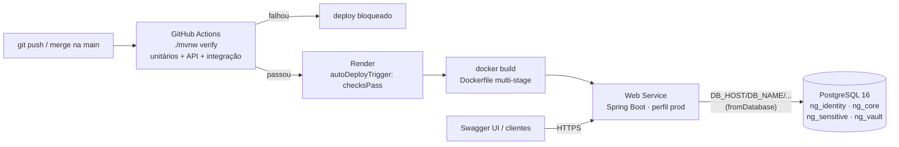

# Implantação em Nuvem — Neuro-Gen

Decisão registrada no **ADR-007** (`docs/defContexto/05-adrs.md`). Resumo: imagem Docker publicada no
**Render** (plano gratuito) com **PostgreSQL 16 gerenciado**, infraestrutura descrita em `render.yaml` e
deploy liberado **somente quando o CI passa**.



## Arquivos envolvidos

| Arquivo | Papel |
|---------|-------|
| `Dockerfile` | Build multi-stage (Maven + JDK 21 → JRE 21 Alpine), usuário sem root, JVM ajustada para 512 MB |
| `render.yaml` | Blueprint: cria o PostgreSQL e o serviço web e injeta as credenciais do banco |
| `src/main/resources/application-prod.yml` | Perfil `prod`: tudo vem de variáveis de ambiente, porta `$PORT`, HTTPS atrás do proxy |
| `.github/workflows/ci.yml` | Pipeline de testes que funciona como portão do deploy |

## Variáveis de ambiente (perfil `prod`)

| Variável | Obrigatória | Origem no Render | Descrição |
|----------|-------------|------------------|-----------|
| `SPRING_PROFILES_ACTIVE` | sim | `render.yaml` | `prod` (também é o padrão da imagem) |
| `DB_HOST`, `DB_PORT`, `DB_NAME`, `DB_USERNAME`, `DB_PASSWORD` | sim | `fromDatabase` | Conexão do datasource Core |
| `SENSITIVE_DATA_KEY` | sim | `generateValue` | Chave AES-256 (Base64 ou hex, 32 bytes) das colunas sensíveis. **Não troque depois de ter dados**: o que foi cifrado com a chave antiga fica ilegível |
| `VAULT_DB_URL`, `VAULT_DB_USERNAME`, `VAULT_DB_PASSWORD` | não | — | Isolamento físico do Cofre em outra instância (ADR-005). Sem elas, usa o mesmo servidor com schema `ng_vault` |
| `PORT` | automática | plataforma | Porta HTTP |

## Passo a passo (primeira implantação, ~15 min)

1. **Levar o código para a `main`.** No GitHub, abra um Pull Request `develop → main` e faça o merge
   **depois que o check "CI" ficar verde**. O Blueprint observa a branch `main`.
2. **Criar conta no Render** em <https://render.com> usando "Sign in with GitHub" e autorize o acesso
   ao repositório `Neuro-Gen`.
3. No painel do Render: **New → Blueprint**, selecione o repositório. O Render lê o `render.yaml` e
   mostra o que será criado (`neurogen-db` e `neuro-gen-api`). Clique em **Apply**.
4. Aguarde o primeiro build (5 a 10 min: baixa as dependências Maven e compila). Acompanhe em
   *neuro-gen-api → Logs*. O deploy termina quando aparecer `Started NeuroGenApplication` e o health
   check passar.
5. **Verifique** (troque pela URL exibida no painel; se o nome estiver em uso, o Render adiciona um sufixo):
   - `https://neuro-gen-api.onrender.com/actuator/health` → `{"status":"UP", ...}`
   - `https://neuro-gen-api.onrender.com/swagger-ui.html` → documentação interativa
6. Coloque a URL pública no `README.md` (seção "Implantação em nuvem").

A partir daí, todo merge na `main` com CI verde é publicado automaticamente.

## Roteiro de demonstração ao vivo (Swagger UI)

> O plano gratuito hiberna após 15 min sem acesso. **Abra a URL ~5 minutos antes** de apresentar.

1. Grupo **1-identity** → `POST /api/v1/auth/register`:
   `{"email":"demo@neurogen.dev","password":"senhaForte123","role":"TITULAR"}` → **201**.
2. `POST /api/v1/auth/login` com o mesmo e-mail e senha → copie o `accessToken`.
3. Botão **Authorize** (cadeado) → cole o token.
4. Grupo **3-agenda** → `POST /api/v1/tasks` com `{"title":"Preparar apresentação","priority":"HIGH"}`
   → **201**, copie o `id`.
5. `POST /api/v1/tasks/{id}/complete` → **200**, `status: DONE`.
6. Repita o passo 5 → **409 `INVALID_TASK_TRANSITION`**: regra criada por TDD neste checkpoint.
7. `GET /api/v1/tasks?status=xyz` → **400 `VALIDATION_ERROR`** (antes era 500).
8. Opcional, segurança do Cofre: registre um usuário `APOIO`, faça login e chame qualquer rota de
   **6-vault** → **403**, com a tentativa auditada.

O token de verificação de e-mail aparece nos **Logs** do serviço (linha `[DEV] Verificação de e-mail`),
pois o envio real de e-mail ainda é simulado (`LoggingEmailSender`). Não é necessário verificar o e-mail
para fazer login.

## Testar a imagem localmente (opcional)

```bash
docker compose up -d                                   # PostgreSQL local (compose.yaml)
docker build -t neuro-gen .
docker run --rm -p 8080:8080 \
  -e DB_HOST=host.docker.internal -e DB_NAME=neurogen \
  -e DB_USERNAME=neurogen -e DB_PASSWORD=secret \
  -e SENSITIVE_DATA_KEY="$(openssl rand -base64 32)" \
  neuro-gen
# Linux: acrescente --add-host=host.docker.internal:host-gateway
```

## Problemas comuns

| Sintoma | Causa provável | O que fazer |
|---------|----------------|-------------|
| Deploy não dispara após merge | CI falhou ou ainda está rodando (`checksPass`) | Veja a aba *Actions* no GitHub; corrija e faça novo push |
| Primeira requisição demora minutos | Serviço estava hibernando | Normal no plano gratuito; aguarde ou acesse antes |
| `401` com token que funcionava antes | Serviço reiniciou e gerou novo par de chaves RSA | Faça login de novo (ver ADR-007) |
| Falha ao subir: `SENSITIVE_DATA_KEY` | Variável ausente | Confira *Environment* do serviço no Render |
| Banco indisponível após ~30 dias | PostgreSQL gratuito expirou | Recrie o banco pelo Blueprint (dados são perdidos) ou faça upgrade |
| `OutOfMemoryError` nos logs | 512 MB no limite | Reduza `DB_POOL_SIZE` ou use o plano Starter |
