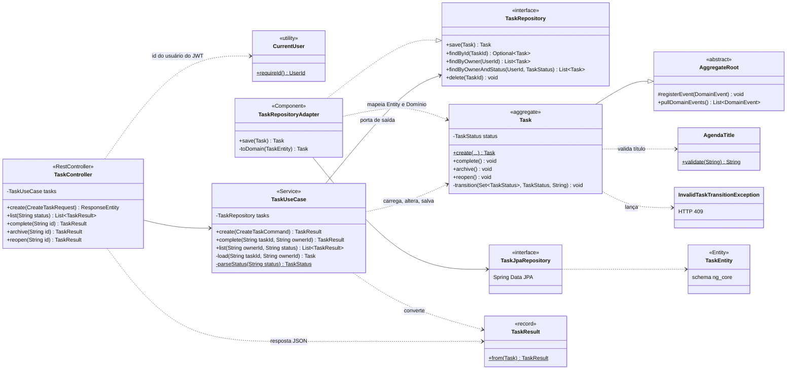
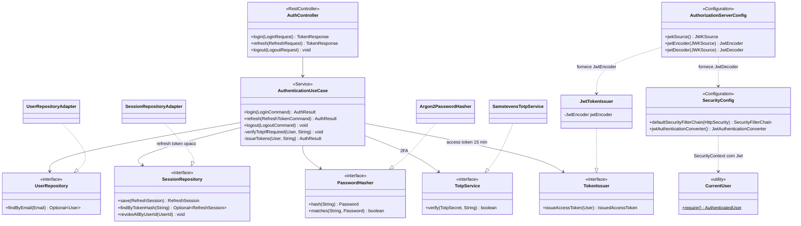
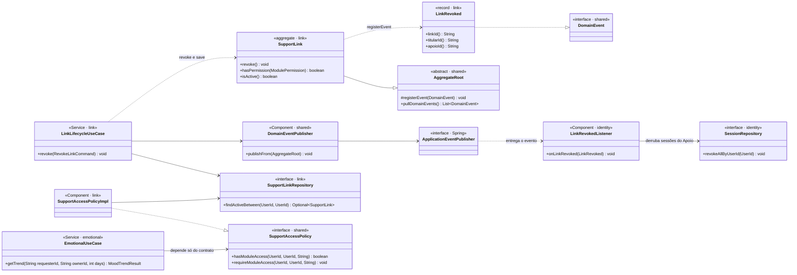
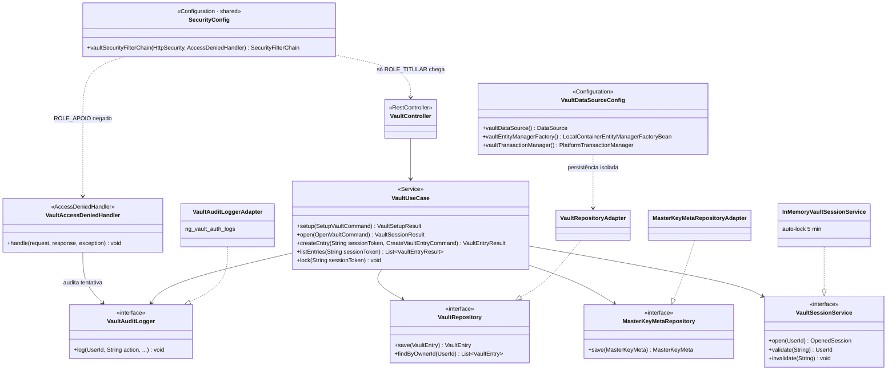
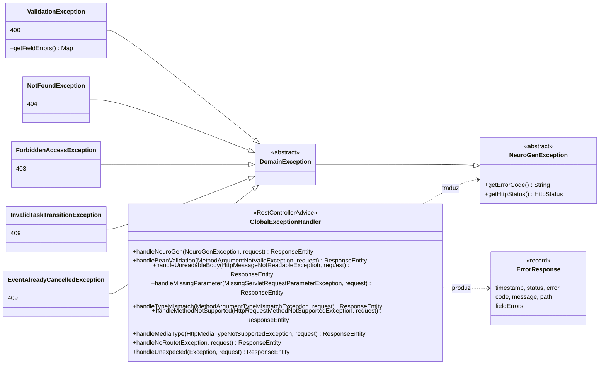

# Diagramas de Classes — Interações entre Componentes

> **Checkpoint 3 · item 4.9.** Os diagramas de `01-diagrama-classes.md` mostram **o que existe dentro de
> cada módulo**. Este documento mostra **como os componentes conversam entre si** nas interações
> principais do sistema. Todos os nomes de classes e métodos correspondem ao código em `src/main/java`.
>
> **Como ler:** `--|>` herança · `..|>` implementa interface · `-->` dependência injetada (campo) ·
> `..>` usa/cria/lança · `<<interface>>` porta da arquitetura hexagonal.

| # | Interação | O que demonstra | Rastreabilidade |
|---|-----------|-----------------|-----------------|
| 1 | Requisição REST atravessando as camadas | Arquitetura hexagonal: o domínio não depende de Spring/JPA | ADR-001, RNF-MAN |
| 2 | Autenticação e autorização com JWT | Emissão (Authorization Server) e validação (Resource Server) | RF-01, RNF-SEC.5/7 |
| 3 | Integração entre módulos | Eventos de domínio e porta compartilhada, sem import entre módulos | ADR-001, RF-01.3/01.4 |
| 4 | Isolamento do Cofre | Negação estrutural do APOIO, datasource próprio, auditoria | ADR-005, RF-08.5 |
| 5 | Tratamento de erros | Exceções de domínio e do Spring traduzidas em respostas HTTP padronizadas | RNF-OBS.1 |

---

## 1. Requisição REST atravessando as camadas (exemplo: concluir uma Tarefa)

Fluxo de `POST /api/v1/tasks/{id}/complete`. O controller só traduz HTTP; o caso de uso orquestra; a regra
de negócio (máquina de estados) mora no agregado `Task`; a persistência fica atrás da porta
`TaskRepository`, implementada na infraestrutura. Trocar JPA por outra tecnologia não altera domínio nem
aplicação — basta outro adaptador.

**Pontos para a apresentação:** a seta `TaskUseCase --> TaskRepository` aponta para uma **interface do
domínio**, não para o JPA (inversão de dependência, o "D" do SOLID). É isso que permite testar o
`TaskUseCase` com Mockito sem banco (`TaskUseCaseTest`) e o `Task` com JUnit puro (`TaskTest`).

---

## 2. Autenticação e autorização com JWT

O login passa pelo `AuthenticationUseCase`, que depende apenas de portas (`PasswordHasher`, `TotpService`,
`TokenIssuer`...). A infraestrutura fornece Argon2id, TOTP e a emissão do JWT assinado com RSA. Nas
requisições seguintes, o Spring Security valida o token com o `JwtDecoder` (mesmo par de chaves) e
converte a claim `role` em autoridade (`ROLE_TITULAR`/`ROLE_APOIO`); os controllers leem o usuário via
`CurrentUser`.

---

## 3. Integração entre módulos sem acoplamento direto

Os módulos não chamam classes internas uns dos outros (ADR-001). Há dois mecanismos:

**3a. Evento de domínio** — ao revogar um vínculo, o agregado `SupportLink` registra `LinkRevoked`; o caso
de uso salva e publica; o módulo **Identity** reage derrubando as sessões do Apoio (RF-01.4). O Link não
sabe que o Identity existe.

**3b. Porta compartilhada** — o módulo **Emotional** precisa saber se um Apoio pode ver os dados do
Titular, mas não pode importar o Link. Ele depende da interface `SupportAccessPolicy`, publicada no
`shared`; a implementação vive no Link e é injetada pelo Spring.

---

## 4. Isolamento do Cofre (zero-knowledge)

O Cofre tem **cadeia de segurança própria**, que exige `ROLE_TITULAR` para qualquer rota `/api/v1/vault/**`.
Um APOIO é barrado **antes** de chegar ao controller — não existe checagem configurável que possa ser
esquecida (RF-08.5). A tentativa negada é auditada. A persistência usa **datasource, EntityManager,
TransactionManager e Flyway próprios** (schema `ng_vault`), configurados no próprio módulo.

O teste de integração `NeuroGenIntegrationTest` (executado no CI com PostgreSQL real) comprova essa
interação: um token APOIO recebe **403** em `/api/v1/vault/entries` e a tentativa aparece em
`ng_vault_auth_logs`.

---

## 5. Tratamento de erros padronizado

Qualquer camada lança exceções da hierarquia `NeuroGenException`, que já carregam código e status HTTP. O
`GlobalExceptionHandler` (um `@RestControllerAdvice`) é o **único** ponto que transforma exceções em
resposta, sempre no formato `ErrorResponse` (inspirado na RFC 7807). No Checkpoint 3 foram adicionados,
via TDD, os handlers para erros de requisição tratados pelo Spring MVC, que antes viravam HTTP 500.

| Situação | Antes | Depois (Checkpoint 3) |
|----------|-------|------------------------|
| JSON malformado | 500 | 400 `MALFORMED_REQUEST` |
| Parâmetro obrigatório ausente | 500 | 400 `MISSING_PARAMETER` |
| Parâmetro com formato inválido | 500 | 400 `INVALID_PARAMETER` |
| Método HTTP não suportado | 500 | 405 `METHOD_NOT_ALLOWED` + cabeçalho `Allow` |
| Content-Type não suportado | 500 | 415 `UNSUPPORTED_MEDIA_TYPE` |
| Rota inexistente | 500 | 404 `RESOURCE_NOT_FOUND` |
| Filtro `?status=` inválido em tarefas | 500 | 400 `VALIDATION_ERROR` |
| Concluir tarefa arquivada / alterar evento cancelado | aceito | 409 |
